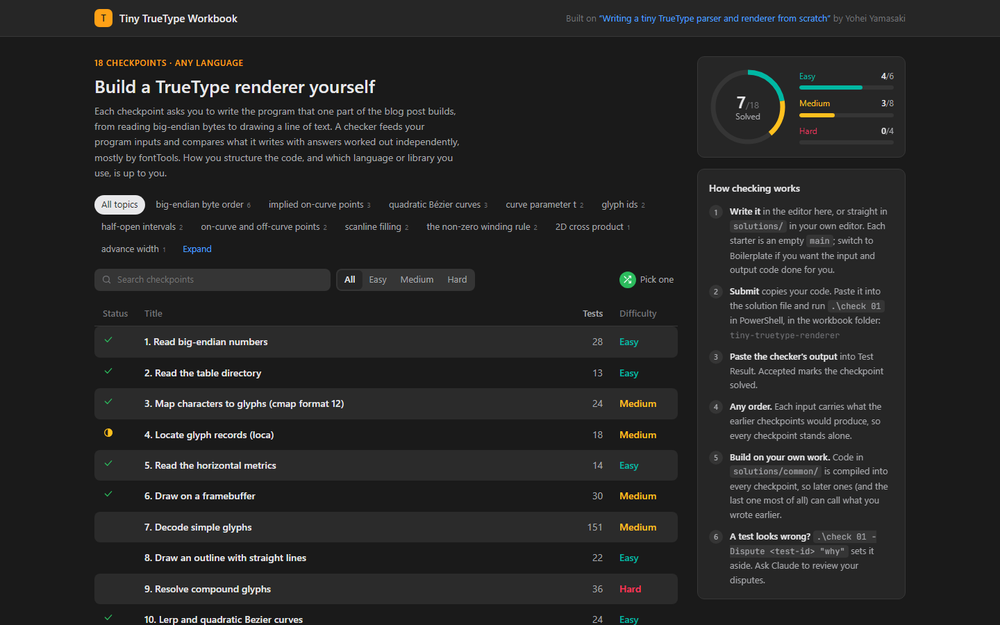

# tech-blog-to-workbook

Turn a technical blog post into a LeetCode-style workbook, so you learn what the post teaches by
building it yourself.

This is a [Claude Code](https://claude.com/claude-code) plugin. Give Claude a link to a post: it
reads the post, turns each idea or code snippet into an assignment, and builds a workbook with
problem pages, starter files, a checker with independently computed answers, and a problem book
that works like a coding-practice site. You write every line, and the checker tells you when
your output is right. By the last assignment you've rebuilt what the post builds, and you know
why it works.


**See it in action:** [techblog-workbooks](https://github.com/knmn2000/techblog-workbooks) is the
collection of workbooks made with this plugin. The first one is an 18-assignment TrueType font
renderer, built on Yohei Yamasaki's post
[Writing a tiny TrueType parser and renderer from scratch](https://yayo1.com/en/blog/tiny-truetype-renderer/).

## What a workbook gives you

- **One kind of exercise: write the program, match the output.** No quizzes and no
  find-the-bug. Even a post with no code has an idea you can implement and test.
- **Your code, your language.** Only the output is checked: each assignment's program runs as
  `<program> <input-file> <output-file>`. Where the post has code, each assignment asks for what
  that snippet accomplishes, not for the author's design. When you set a workbook up, Claude asks
  which language you want (C, C++, Go, Rust, Python, JavaScript, TypeScript or Lua), shows which
  are installed and how to install the rest, and sets up only that one.
- **Blank starters.** Each file starts as a comment saying what belongs in it (and an empty
  `main` in the assignment's program), so working out the imports, the API and the input parsing
  is part of the exercise. A boilerplate with the input and output done, and declarations named as
  the author names them, is one click away if you want it.
- **You build a real project, not a pile of exercises.** You go through the assignments in order,
  and each one's work is saved as a properly named file in a project layout modelled on the
  author's own. Later assignments import your earlier files, and the last one is the project's
  real `main`, so when you finish, your code reads like an implementation of the post. Each test
  input still carries what the earlier assignments would produce, so an assignment's tests only
  depend on the earlier files you choose to use.
- **Full problem pages.** A description, numbered requirements, worked examples, constraints,
  sources and tags (language features, libraries, concepts), four hints that open in order, and
  an Editorial with a complete solution that's proven to pass every test, then a comparison with
  the author's code. It opens when you pass and is one click away before that.
- **Tests you can trust.** Expected answers come from an independent source (a library, a
  specification, a hand calculation), never from the reference solution. Every test traces to a
  requirement, and the checks are checked before an assignment ships:
  - the reference solution passes;
  - planted bugs fail, including any bug in the post's own code;
  - different-but-correct solutions pass;
  - a separate solver passes using only the problem page.
- **Never blocked by a wrong test.** `-Dispute` sets a test aside so you can carry on, and
  `-Fresh` generates new tests you haven't seen. Ask Claude to "review my disputes" and it fixes
  the test or shows you the evidence.
- **A problem book that runs your code.** A problem list with progress and topic filters, then a
  split view with the statement, an editor and the test cases. Double-click `study.cmd` in the
  workbook (or ask Claude to "open my workbook") and Run and Submit build and check your code
  right there: the verdict, the failing tests, and for pictures the expected, yours and the
  difference side by side. Your code is saved to the workbook as you type, and edits from your own
  editor show up too.
- **One-step setup.** Claude checks the tools the workbook needs, asks which language you want,
  offers to install anything missing, creates your project and opens the book. Coming back later is
  a double-click, and the book's Exit button stops it when you're done.

| Problem list | Test result |
|---|---|
|  |  |

## Install

In Claude Code:

```
/plugin marketplace add knmn2000/tech-blog-to-workbook
/plugin install tech-blog-to-workbook@tech-blog-to-workbook
```

Then ask for a workbook in your own words, for example:

```
Turn https://example.com/some-post into a workbook I can learn from, in C++.
```

**Needs:** Claude Code, ideally the desktop app (its browser pane reads posts best; WebFetch is
the fallback), Python 3, and a compiler or runtime for your language. C++ (g++, CMake and Ninja)
has the most complete templates; learners can still solve any workbook in any of the eight
built-in languages, and the checker tells them how to install a missing one. Some workbooks need a
library to compute expected answers (the TrueType one uses fontTools); Claude asks before
downloading anything.

## How it builds a workbook

1. **Read the post.** Claude extracts the headings, text and code blocks. That copy stays on your
   machine and is never put in the workbook.
2. **Map it to assignments.** Each snippet or idea becomes an assignment with an input/output
   contract, an independent source of expected answers, a difficulty, and its file in the
   project layout (modelled on the author's, when they published code). You approve the map and
   the layout before anything is written.
3. **Scaffold the workbook:** checker, image comparison, problem book builder, check scripts and
   README.
4. **Write the assignments.** One complete model assignment first, then the rest (in parallel,
   for long posts). Each gets a problem page, a boilerplate starter, a reference solution
   written from scratch, and a test generator.
5. **Check the checks** (see above), and fold the independent solver's feedback into the pages.
6. **Hand it over:** blank starters go into `solutions/`, and the problem book is built.

## Roadmap

- Textbook chapters as input, alongside blog posts.
- Ready-made boilerplate templates for more languages.
- More workbooks in [techblog-workbooks](https://github.com/knmn2000/techblog-workbooks).

## Contributing

Issues and pull requests are welcome: bugs in the checker or the book, ideas for the workflow, or
posts that broke it. To share a workbook you made, open a pull request on
[techblog-workbooks](https://github.com/knmn2000/techblog-workbooks).

## Repository layout

```
.claude-plugin/              plugin and marketplace manifests
skills/blog-to-leetcode/
  SKILL.md                   the workflow Claude follows
  references/                mapping a post to assignments, test trust, authoring guide, languages
  scripts/                   reading the post, scaffolding a workbook, stripping hints
  assets/workbook-template/  checker, image comparison, book builder and template, check scripts
  assets/lang/cpp/           the learner's project skeleton (CMake, README), an optional canvas
  assets/example-assignment/ a complete worked assignment, laid out as in a workbook
docs/screenshots/
```

## Respecting authors

Workbooks link to the post's sections and explain everything in their own words. They never copy
the post's text or code, and reference solutions are written from the specification, not from
the author's repository.

## Licence

[Apache License 2.0](LICENSE). Copyright 2026 knmn2000.
